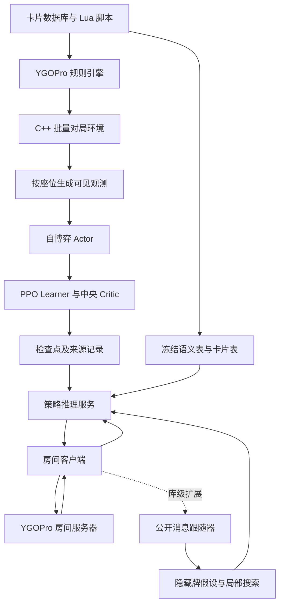

# MirrorForce 技术文档

本文面向希望阅读、运行和二次开发 MirrorForce 的开发者，依据本次克隆的源码与仓库文档整理。运行命令是部署参考，尚未在本机完成编译、训练或对局验证。

| 项目 | 内容 |
|---|---|
| 上游仓库 | https://github.com/tommy85/MirrorForce |
| 本地目录 | `F:\YGOagent`（仓库文件直接位于当前目录） |
| 整理日期 | 2026-10-27 |
| 主仓库提交 | `45f4e0187f64660710c72e85ad5cbc59823b95c0` |
| 主仓库提交日期 | 2026-10-09 |
| 引擎子模块 | `third_party/ygopro-core` |
| 锁定的引擎提交 | `5760bde478561601a6ec6b4fc7f23f0ba351c3b6` |

## 1. 项目定位与能力边界

MirrorForce 是基于 YGOPro 规则引擎、通过自博弈强化学习训练的《游戏王》OCG 智能体。核心决策由 JAX/Flax 实现的实体 Transformer 完成，不依赖大语言模型在线理解卡片文字。

仓库包含训练系统、推理服务、房间客户端、规则引擎扩展、公开信息跟随器及搜索库。发布权重主要针对闪刀姬镜像对局；目录里存在其他卡组，并不意味着发布模型已经掌握这些卡组。

上游报告冠军策略约有 2810 万参数，使用 32 张 H20 训练约 3 天。这些是上游实验信息，不是本次本地复现结果，也不是最低运行配置。

需要区分以下能力：

| 能力 | 当前版本状态 |
|---|---|
| 自博弈训练 | 提供分布式训练代码和冠军配置 |
| 发布模型推理 | 提供服务、联赛客户端及本地对局工具；权重需另行获取 |
| 在线搜索 | 提供库实现；发布的客户端和本地对局工具尚未接入完整搜索对局 |
| 对手隐藏牌预测 | 存在辅助 belief 头；普通策略不读取它的预测输出 |
| belief 辅助搜索 | 库提供 count-head 重采样方案，不代表发布客户端已经使用 |
| 多卡组泛化 | 架构可以扩展，但当前发布权重没有通用多卡组能力保证 |

## 2. 系统架构



训练和在线推理共享观测约定，目的是让训练时的输入与真实客户端可获得的信息一致。中央 Critic 可在训练阶段读取双方信息，用于降低价值估计与优势估计的噪声；它不负责在线选择动作。

### 2.1 主要目录

以下路径均相对于仓库根目录。外层 `mirrorforce/` 是运行工作目录，内层 `mirrorforce/mirrorforce/` 才是 Python 包。

| 路径 | 职责及重点入口 |
|---|---|
| `mirrorforce/mirrorforce/agent/model/` | 网络实现；重点为 `policy_net.py`、`critic.py` |
| `mirrorforce/mirrorforce/agent/train/` | `cleanba.py` 训练编排、`ataraxos.py` 损失、`checkpoint_store.py` 检查点管理 |
| `mirrorforce/mirrorforce/agent/env/` | 原生环境加载及 Python 环境接口 |
| `mirrorforce/mirrorforce/agent/semantics/` | 从数据库与脚本构建冻结语义特征 |
| `mirrorforce/cxx/duelpool/` | C++ 批量对局环境、线程池框架和 `build.py` |
| `mirrorforce/cxx/mfenv/` | 消息、公开历史、编码及公共状态跟踪 |
| `mirrorforce/mirrorforce/netduel/` | 房间协议、客户端、公开牌面、计时及搜索策略 |
| `mirrorforce/mirrorforce/common/` | `client_sync.py`、`client_shadow.py`、`client_root.py` 等跟随器与共享逻辑 |
| `mirrorforce/mirrorforce/search/` | 隐藏牌粒子、状态分支及引擎重建支持 |
| `mirrorforce/mirrorforce/worldmodel/`、`puzzle/` | 引擎驱动、状态生成与 ctypes 加载 |
| `mirrorforce/tools/` | 推理服务、联赛客户端、本地对局、场景训练及审计工具 |
| `mirrorforce/tests/` | 单元测试、契约测试、原生环境测试及回归数据 |
| `mirrorforce/sdk/room/` | 为自定义智能体提供的简化房间 SDK |
| `deck/`、`mirrorforce/decks/` | 发布卡组及训练用卡组 |
| `replay/` | 上游提供的人类对局录像 |
| `third_party/ygopro-core/` | 经修改的 YGOPro 引擎，作为 Git 子模块锁定版本 |

## 3. 信息边界与观测编码

策略只应接收当前座位可见的信息：自己的手牌、已知卡组构成、公开区域、公开历史及被揭示的信息。对手隐藏卡身份与真实牌库顺序不得进入策略输入。

公开身份和已知位置是两个不同概念。一张已公开的卡在洗手牌等操作后，可能仍然知道它位于某个区域，却不知道具体位置。项目通过披露账本和 `unpositioned_` 表示这类知识，避免凭空恢复顺序。未知身份以卡片编号 0 表示。

主要观测张量如下，详细字段见 [features.md](features.md)：

| 字段 | 形状或容量 | 含义 |
|---|---|---|
| `cards_` | 卡片数 × 41 | 卡片动态属性、区域、控制者、攻防及类型等 |
| `card_status_` / `card_turn_` | 卡片数 × 6 / × 8 | 公开状态与本回合卡片记录 |
| `global_` | 25 | LP、阶段、回合及房间格式等 |
| `own_recipe_` / `opponent_recipe_` | 80 × 6 / 80 × 4 | 已知卡组构成与剩余计数 |
| `unpositioned_` | 32 × 4 | 已知区域但未知具体位置的对手卡身份 |
| `public_effects_` | 16 × 8 | 持续生效的公开玩家效果 |
| `turn_events_` / `turn_event_refs_` | 512 × 27 / 512 × 4 | 当前回合事件及关联卡片 |
| `chain_` | 8 × 8 | 当前连锁 |
| `action_ir_` | 选项数 × 24 | 合法动作的结构化描述 |
| `action_single_refs_` | 选项数 × 4 | 单卡引用 |
| `action_group_refs_` | 选项数 × 5 × 8 | 素材、代价、目标等卡片组引用 |

多卡选择会拆成连续的单项决策。冠军训练配置最多保留 192 个动作选项，每局最多 1000 个决策步骤。因此，“对可变数量动作打分”不等于实际配置没有容量上限。

## 4. 策略网络

### 4.1 卡片表示

每张卡的 token 由动态观测、冻结语义特征和可学习的卡片身份残差组合而成。上游发布语义表覆盖 14,969 张卡，每张卡有 78 项精确数据库特征，以及最多 16 个从 Lua 脚本提取的效果单元；每个效果单元使用 64 维哈希语义特征。

这是结构化特征与脚本语义提取，不是调用语言模型生成卡片文本嵌入。特征表与数据库、脚本版本绑定，不能随意替换后沿用旧检查点。

### 4.2 冠军配置与代码默认值

`PolicyNetConfig` 的默认值与发布模型配置并不相同。下表用于避免直接使用默认构造器复现出错误规模：

| 参数 | 冠军训练配置 | 当前配置类默认值 |
|---|---:|---:|
| 隐藏宽度 `d` | 384 | 768 |
| 注意力头数 `heads` | 8 | 12 |
| 前馈宽度 `ff` | 1536 | 3072 |
| 状态层数 `state_layers` | 4 | 6 |
| 回合层数 `turn_layers` | 2 | 2 |
| 读出层数 `readout_layers` | 2 | 2 |
| belief 宽度 | 128 | 256 |

加载发布权重时应使用其记录的模型配置；从头训练时按 [training.md](training.md) 明确设置参数。冠军配置还启用了 `hand_limit`、`public_status`、`value_menu` 等默认关闭的特征。

### 4.3 历史与输出头

状态 Transformer 编码卡片及全局信息；因果 Transformer 编码当前回合事件。历史回合压缩为摘要 token，最多保存 64 个；超长当前回合使用每块 64 行、最多 48 块的摘要。记忆按座位维护，跨决策增量更新。

读出层融合状态与回合历史，随后输出：

- **策略头**：动作作为查询关注状态，对每个合法动作产生 logit，并屏蔽无效动作。
- **价值头**：预测胜、平、负分布，标量价值为 `P(胜) - P(负)`。
- **belief 头**：预测对手隐藏卡组成，作为辅助训练任务；其输出不直接反馈到普通策略决策。

冠军模型以 bfloat16 计算、float32 保存参数。训练用中央 Critic 约 940 万参数，与策略网络分开。

## 5. 自博弈训练流程

1. Actor 在 C++ 批量环境中运行多局对战，双方使用当前策略采样动作。
2. 按座位收集轨迹、价值和隐藏牌监督目标；游戏王的决策不是严格轮流交替，因此回报链按各自座位组织。
3. Learner 使用 PPO-clip 更新策略，训练价值头与 belief 头，并更新中央 Critic。
4. 发布新参数给 Actor，保存检查点、EMA、优化器状态和来源记录。

上游训练损失可概括为：

```text
总损失 = PPO-clip（裁剪阈值 0.2）
       + 温度 × KL（当前策略 || 合法动作均匀分布）
       + 1.0 × 分类价值损失
       + 0.1 × KL（当前策略 || 行为策略）
       + 0.1 × 隐藏牌预测损失
```

优势估计采用 GAE（λ=0.5），策略价值目标采用分类 TD（λ=0.8）。每个设备、每个批次保留满足 `|A| ≥ max(75%分位数, 0.01)` 的决策，该过滤应用到整个损失。温度与学习率随样本进度衰减。

冠军实验每轮约采集 491.52 万决策，执行 200 次优化器更新，总计 5120 个环境。EMA 衰减为 0.999，但发布冠军使用的是 `iterate` 权重；推理服务的 `--weights` 默认值为 `ema`，复现时必须显式指定 `iterate`。

新训练不能直接照抄冠军命令中的 `--critic-advantages`。上游要求先让 Critic 学习，验证其优于策略价值头后，再通过比较证据文件切换优势来源。

### 5.1 定向场景训练

冠军训练在第 1000 轮进行过一次脚本场景监督微调，然后继续自博弈。场景注册表位于 `mirrorforce/data/specialization/scenes.json`，上游记录 96 个场景，其中 62 个用于训练、34 个留出验证。

流程为：场景引擎演示 → 公共消息记录 → 客户端可见观测与动作标签 → Actor 微调 → 留出场景验证 → 将 Actor 写回训练检查点。入口包括 `mf_runtime_scene_tapes.py`、`mf_runtime_specialize.py` 和 `policy_repair.py`。

因此，主训练以自博弈为基础，但冠军的完整训练过程还包含脚本场景监督阶段。

## 6. 在线推理与搜索

### 6.1 普通对局链路

策略服务 `mf_runtime_policy_service.py` 加载检查点、校验资源并预热模型，通过 Unix 域套接字服务客户端。基础会话操作为 `identity`、`open`、`decide`、`close`；源码还包含公开流及搜索诊断扩展操作。

房间客户端读取服务器消息，维护当前座位视图，将决策请求发给服务，再把响应编码回房间协议。房间计时与超时处理由客户端负责。服务连接结束时会清理该连接拥有的会话。

联赛工具额外校验计划摘要、服务身份和权重身份。凭证文件必须是当前用户拥有、权限为 `0600` 的普通小文件，且不跟随符号链接；这一实现依赖 POSIX 行为。

### 6.2 搜索库流程

跟随器用本地引擎重放客户端收到的公开消息，推断未直接传来的对手选择及随机结果，并比较两边消息是否一致。它无法读取服务器真实隐藏状态。

搜索在当前根节点构造符合公开信息的隐藏牌假设，将其写入引擎快照，在共享假设和随机流下评估合法根动作，随后以价值头评分更新动作分布。上游配置通常向前模拟最多五个己方决策或直到终局。

房间搜索配置使用 8 个假设，决策窗口 10 秒（含准备与普通策略前向），另留 3 秒用于清理及发送。触发条件包括策略不确定或公开信息下可能存在斩杀；这不是斩杀证明。

`final_search.settings("on")` 只生成配置，仍需模型绑定的数值、原生终局及时间预算等证据校验。不能把它理解为一个已可用于发布客户端的搜索开关。上游尚未报告搜索相对普通策略的可测收益，跟随器失同步也没有可靠的普通策略回退保证。

## 7. 环境准备与构建

### 7.1 平台与外部资源

上游支持路径是 **Linux x86-64 + Python 3.11**。本次工作区为 Windows，下面命令是 Linux Bash 命令；可在另行配置的 WSL2 或 Linux 主机中执行，但本次未验证 WSL 环境。

仓库克隆完成不等于运行环境安装完成。还需准备：

| 资源 | 来源或要求 |
|---|---|
| Python 依赖 | 根目录 `requirements.txt`；JAX/JAXLIB 0.5.3、Flax 0.10.4、NumPy 1.26.4 等 |
| GPU 依赖 | 训练时使用匹配版本的 CUDA JAX，并配置驱动与设备 |
| 补充 Python 包 | 部分共享模块和跟随器使用 torch、pyarrow；requirements 中仅注释提示，未锁定安装版本 |
| 编译工具 | C++17 编译器、Lua 5.3、SQLite 开发文件 |
| 原生构建快照 | `mirrorforce/cxx/duelpool/deps.json` 列出的精确目录与 SHA-256 |
| 卡片与脚本 | `cards.cdb`、`script/`，源码仓库不包含完整运行数据 |
| 模型与特征 | 发布包的检查点、代码列表、语义表、卡片表、声明表及对应来源记录 |

发布资源入口：[GitHub Releases](https://github.com/tommy85/MirrorForce/releases)。本次未下载发布权重、完整卡片数据库或脚本包。

特别注意：`deps.json` 将依赖标为私有快照，构建脚本会逐个核验目录哈希。普通系统包或同版本源码不保证字节一致；仓库没有提供一个自动获取所有这些快照的一键构建步骤。需要先获得匹配快照，或作为独立开发工作重新建立并验证依赖清单。

### 7.2 Python 环境

```bash
# 在 Linux 中设置实际仓库路径
export MF_REPO=/path/to/YGOagent
cd "$MF_REPO"
python3.11 -m venv .venv
source .venv/bin/activate
python -m pip install -r requirements.txt

# GPU 工作流按需安装，版本与仓库固定依赖保持一致
python -m pip install 'jax[cuda12]==0.5.3'
```

### 7.3 独立规则引擎

```bash
cd "$MF_REPO"
MF_CORE_ROOT="$MF_REPO/third_party/ygopro-core" \
MF_BUILD_ROOT="$MF_REPO/local-build" \
MF_LUA_INC=/usr/include/lua5.3 \
    bash mirrorforce/build/effectinfo/build-effectinfo-core.sh

export MF_EFFECTINFO_LIB="$MF_REPO/local-build/effectinfo/libygopro-core-effectinfo.so"
```

显式指定 `MF_CORE_ROOT` 很重要：该脚本默认指向根目录下的 `ygopro-core`，而当前子模块实际位于 `third_party/ygopro-core`。

### 7.4 批量环境扩展

在获得与 `deps.json` 匹配的依赖快照后执行：

```bash
cd "$MF_REPO"
python mirrorforce/cxx/duelpool/build.py \
    --rev "$(git rev-parse HEAD)" \
    --core "$MF_REPO/third_party/ygopro-core" \
    --core-rev "$(git -C third_party/ygopro-core rev-parse HEAD)" \
    --deps /path/to/dependency-snapshots \
    --out "$MF_REPO/local-build/duelpool-v1"

export MF_DUEL_NATIVE="$MF_REPO/local-build/duelpool-v1/duel_native.cpython-311-x86_64-linux-gnu.so"
```

`--out` 必须是尚不存在的新目录。`--rev` 从 Git 提交归档源码，未提交修改不会进入构建。源码还提供开发用途的 `--worktree`，它与 `--rev` 互斥；部署复现应优先使用明确提交。

### 7.5 常用环境变量

| 变量 | 用途 |
|---|---|
| `MF_DUEL_NATIVE` | Python 原生环境扩展 `.so` |
| `MF_EFFECTINFO_LIB` | 独立规则引擎 `.so` |
| `MF_YGOPRO_RUN` | 含 `cards.cdb` 和 `script/` 的客户端资源目录 |
| `MF_YGOPRO_DB` | 单独指定卡片数据库 |
| `MF_TEST_ASSETS` | 原生测试使用的特征表等资源 |
| `MF_SCRIPTED_RUN` | 脚本场景测试使用的客户端目录 |
| `PYTHONPATH` | 应包含仓库外层 `mirrorforce/` |

## 8. 推理、测试与训练入口

下面命令中的路径和摘要占位符需要替换，资源必须与检查点来源记录一致。

### 8.1 启动发布策略

```bash
cd "$MF_REPO/mirrorforce"
export MF_BUNDLE=/path/to/release-bundle

python -m tools.mf_runtime_policy_service \
    --checkpoint "$MF_BUNDLE/checkpoint/<sha256>.ckpt" \
    --weights iterate --selection greedy \
    --cards-db "$MF_BUNDLE/cards.cdb" \
    --code-list "$MF_BUNDLE/code_list.txt" \
    --script-root "$MF_BUNDLE" \
    --announce-tables "$MF_BUNDLE/announce-tables-<sha256>.json" \
    --semantic-file "$MF_BUNDLE/frozen_semantics.npz" \
    --card-tables "$MF_BUNDLE/card-tables-<sha256>.npz" \
    --warmup-deck decks/stage-a/SkyStriker.ydk \
    --opponent-mode mirror \
    --socket /tmp/mirrorforce-policy.sock \
    --out /path/to/new-service-output
```

`--script-root` 指向包含 `script/` 的父目录。服务输出 `SERVICE-READY` 后再启动客户端；如果身份或文件哈希校验失败，应检查发布资源是否混用了不同版本。

### 8.2 房间计划预检查

```bash
python -m tools.mf_runtime_league_client \
    --plan /path/to/plan.json --plan-sha256 <计划文件摘要> \
    --credentials-file /path/to/credentials.json \
    --out /path/to/new-league-output --prepare-only
```

预检查不连接房间。计划结构由 `mf_runtime_league_client.py` 中的 `validate_plan` 校验，可结合 `test_mf_runtime_league_client.py` 与 `test_netduel_league.py` 理解；不是随意填写主机和卡组字段即可使用的宽松配置。

### 8.3 本地对局

```bash
python -m tools.mf_runtime_local_match \
    --a /tmp/mirrorforce-policy.sock --b /tmp/mirrorforce-policy.sock \
    --deck decks/stage-a/SkyStriker.ydk \
    --cards-db "$MF_BUNDLE/cards.cdb" --script-root "$MF_BUNDLE" \
    --native "$MF_DUEL_NATIVE" --games 20 \
    --out /path/to/new-match-output
```

两个 socket 相同表示同一策略自我对战。工具按同一发牌交换先后手，生成 `summary.json` 汇总先手、后手及整体胜负平结果。

### 8.4 测试与回归

```bash
cd "$MF_REPO/mirrorforce"
PYTHONPATH=. python -m pytest tests -q -p no:cacheprovider
```

测试涉及公开信息边界、观测编码、模型、训练恢复、房间协议、搜索数值与时间预算、跟随器重放等。部分原生测试缺少库或数据时会跳过，但 Python 导入依赖仍需安装；不能把“存在跳过机制”理解为任意空环境都能跑完测试。

跟随器问题可从 `mf_runtime_follower_replay_audit.py` 入手，对照录制消息查找首个不一致位置。更改信息披露或牌面编码时，优先检查 `test_client_disclosure.py`、`test_wire_projection.py` 及相关公开信息回归测试。

### 8.5 训练与恢复

```bash
export PYTHONPATH="$MF_REPO/mirrorforce"
cd "$MF_BUNDLE"
python -m mirrorforce.agent.train.cleanba --help
```

训练环境从工作目录的 `script/` 读取脚本，因此训练应在资源目录执行，而不是机械沿用推理工具的工作目录。完整冠军参数、分布式启动方式与恢复命令见 [training.md](training.md)。

恢复发布检查点需要先通过 `checkpoint_store arrive` 注册；改变拓扑或原生环境时，上游流程使用 `--resume-topology-change`、`--resume-env-change` 记录变化。检查点和表文件的摘要检查应保留，以避免无意中改变实验条件。

## 9. 常见问题与开发建议

| 现象 | 优先检查 |
|---|---|
| 找不到 `mirrorforce` 或 `tools` 模块 | 是否在外层 `mirrorforce/` 工作目录运行，或正确设置了 `PYTHONPATH` |
| 找不到 `.so` / 无法加载原生库 | Linux/Python ABI 是否匹配，`MF_DUEL_NATIVE` 和 `MF_EFFECTINFO_LIB` 是否指向实际产物 |
| 引擎构建找不到源码 | `MF_CORE_ROOT` 是否显式指向 `third_party/ygopro-core` |
| `dependency snapshot differs` | 依赖目录的内容是否与 `deps.json` 一致，而不仅是版本号相同 |
| 输出目录已存在 | 为原生构建和运行产物选择新的目录 |
| 检查点或表校验失败 | 数据库、脚本、语义表、权重及来源记录是否来自同一资源集 |
| 推理表现与发布配置不一致 | 是否误用了默认 EMA、采样选择、不同网络配置或不同房间规则 |
| 训练找不到卡片脚本 | 当前工作目录是否包含 `script/` |
| 凭证读取失败 | 是否在 POSIX 环境，文件归属及 `0600` 权限是否满足要求 |
| 跟随器失同步 | 审计首个不同消息，核对服务器规则、脚本及引擎版本 |

建议先完成“资源与原生库 → 单策略服务 → 本地对局 → 房间接入”的验证，再开展训练或搜索集成。扩展卡组时同时处理卡组采样、公开对手卡组假设、语义覆盖与评估分布，不能只替换 `.ydk` 文件便假设原权重适用。

修改观测张量或语义特征时，需要同步考虑 C++ 编码、Python 模型输入、在线客户端、检查点契约及回归测试。修改搜索时，应单独验证公开信息一致性、推理批量的数值稳定性和完整决策的时间预算。

## 10. 本次交付与验证范围

本次完成源码克隆、引擎子模块初始化及中文技术文档整理。核对了主仓库和引擎提交、原生构建逻辑、模型配置默认值、服务参数、联赛凭证检查与搜索配置。

本次没有安装训练依赖、下载模型资源、编译 Linux 原生扩展或执行模型训练与完整对局测试。因此，这份文档证明的是源码结构与部署条件经过核对，不代表当前 Windows 目录已经可以直接运行智能体。

## 11. 许可证与参考资料

主项目采用 MIT；EnvPool 派生代码包含 Apache-2.0 声明，部分 Lua 脚本使用 GPL-2.0。分发时需按具体文件保留相应声明，不能将全部资源统一视为 MIT。详见 [LICENSE](../LICENSE) 和 [THIRD_PARTY_NOTICES.md](../THIRD_PARTY_NOTICES.md)。

建议阅读顺序：

1. [项目 README](../README.md)：目标、发布能力及已知问题。
2. [系统架构](architecture.md) 与 [特征定义](features.md)：信息边界与数据流。
3. [模型](model.md) 与 [训练](training.md)：网络结构、训练配置与实验过程。
4. [运行指南](usage.md)：构建和工具命令。
5. [搜索设计](search.md)：跟随器、隐藏状态假设及搜索限制。

上游概述文档有时以架构能力描述搜索；判断发布工具能否直接使用时，应结合 README、usage、search 及当前源码，采用本文明确区分的“库实现”和“已接入客户端”两种状态。
